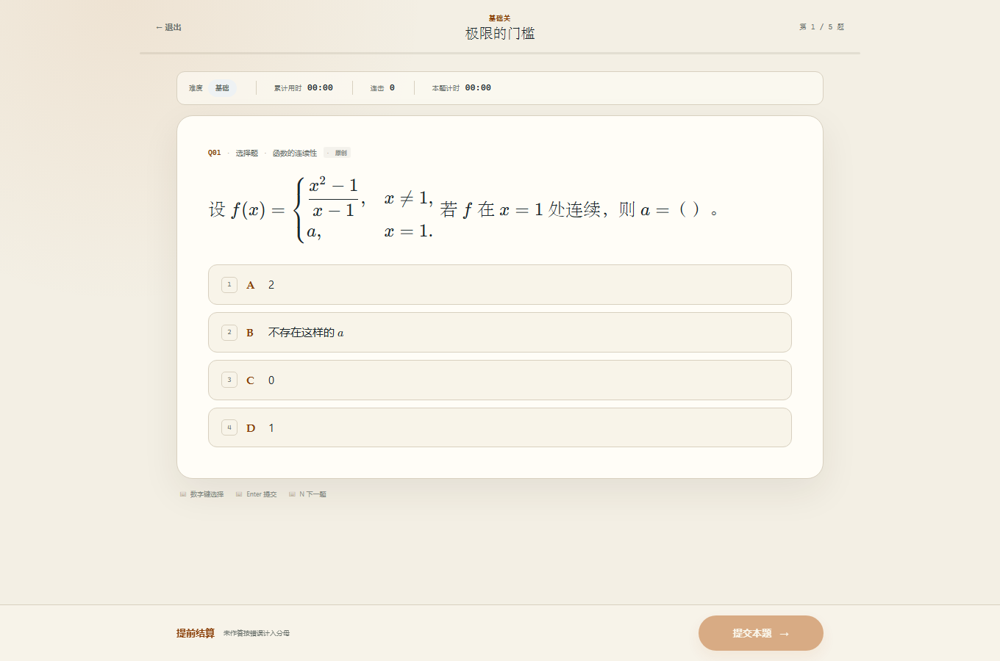
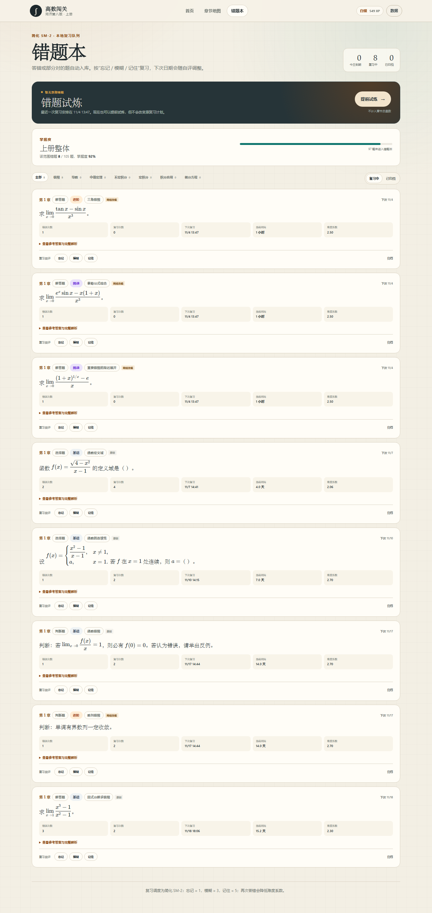

# 高数闯关 · 同济第八版上册

一个纯前端、本地优先的高等数学闯关刷题 Web 应用。七章、二十一关、一百零五道题，覆盖选择、判断、解答三类题型。所有进度、错题与设置只保存在当前浏览器的 IndexedDB，不设账号、不建后端、不发起业务网络请求。


## 启动

环境：Node.js 18+（本项目在 Node 24 下构建与验证）。

```bash
npm install
npm run dev
```

打开终端打印的地址，默认是 <http://localhost:5173>。首次打开会自动写入内置题库与个人档案。

Windows 也可以直接双击项目根目录的 启动.cmd：它会检查依赖、在独立窗口启动 `dev:lan`，并打开浏览器；关掉那个服务器窗口即停止。

生产构建与预览：

```bash
npm run build
npm run preview
```

## 在其他设备 / 手机上使用

这是一个纯静态应用，**只要能访问到页面，任何设备都能用**；不需要后端或账号。三种方式：

### 1. 同一 Wi-Fi 下用手机打开（最快）

```bash
npm run dev:lan      # 开发模式，监听 0.0.0.0
# 或
npm run build && npm run preview:lan   # 构建版，监听 0.0.0.0:4173
```

手机与电脑连同一个 Wi-Fi，访问 `http://<电脑的局域网 IP>:5173`（或 `:4173`）。Windows 首次会弹防火墙提示，勾选“专用网络”允许 Node.js。查本机 IP：`ipconfig`，找 IPv4 地址。

### 2. 部署到静态托管（推荐长期使用）

`npm run build` 后把整个 `dist/` 目录上传到任意静态托管即可：GitHub Pages、Netlify、Vercel、Cloudflare Pages、nginx 或对象存储。构建产物使用**相对路径**（`base: './'`），放在域名根目录或子目录（如 `https://user.github.io/gaoshu/`）都能直接运行；没有环境变量、没有服务端配置。

部署后请用 **HTTPS** 访问（主流静态托管默认提供），这是手机安装与离线使用的前提。

### 3. 安装成手机 App，之后不再需要电脑（推荐）

构建产物是可安装的 PWA（manifest + 主屏幕图标 + Service Worker）。把它部署到任意 HTTPS 地址后：

1. 手机浏览器打开该地址一次；
2. Android Chrome：右上菜单 →「安装应用」（或「添加到主屏幕」）；
   iPhone Safari：底部分享按钮 →「添加到主屏幕」；
3. 从桌面图标启动，全屏运行；之后断网、关掉电脑都能正常刷题。

首次安装会把页面、脚本、样式、题库和 KaTeX 公式字体（构建时约 72 个文件）缓存到本机；后续只有“重新部署后的更新”需要联网打开一次，Service Worker 会自动替换旧缓存。

注意：Service Worker 只在**安全上下文**中可用。`https://` 或 `localhost` 可以；局域网 `http://192.168.x.x` 只能在线打开，不能安装、也不能离线。也就是说，**第一次安装仍然需要一次联网访问**（用免费静态托管即可），装好之后才完全脱离电脑。

### 数据不会自动跨设备同步

进度存在浏览器的 IndexedDB 里，按“浏览器 + 站点地址”隔离。换设备、换浏览器，或换了域名/端口，都会看到一份全新进度。迁移方法：

1. 旧设备：右上角“数据 → 导出完整备份 JSON”；
2. 新设备：打开同一地址 → “数据 → 恢复备份”选择该文件。

本机同一浏览器内刷新、关闭再打开不会丢；清理浏览器站点数据会丢，请定期导出备份。

### 手机端适配现状

- 已按 680px 以下断点做单列布局，实测 492px 宽 Chromium 下首页、地图、错题本、结算、刷题均无横向溢出；公式块超出时自动缩放，内联公式在自身区域内滚动。
- 输入框在手机宽度下统一为 16px，避免 iOS Safari 聚焦时自动放大页面；刷题页底部按钮与独立窗口顶部已适配 `safe-area-inset-*`。
- 已做成可安装的 PWA：manifest、主屏幕图标（192/512 + Apple Touch Icon）、Service Worker 离线缓存齐全；首页在手机宽度下会显示一次安装引导，点“知道了”后记录在 IndexedDB，不再打扰。
- 尚未在真实 iPhone / Android 实机上跑过（本次审计环境只有 Chromium）。Safari 的差异主要在惯性滚动、地址栏高度和安装入口文案，不影响功能；如果遇到具体机型问题，告诉我机型与现象。

## 使用

1. 首页或章节地图进入关卡。先看目标卡：五题、题型与难度分布、目标用时、三星条件、XP 范围。
2. 选择题按选项身份判分、每次洗牌；判断题按布尔值判分；解答题在刷题页只保存作答。
3. 每题独立计时。提交后只显示本题用时，不立即揭晓对错。刷新页面会接着计时；只有离开超过 10 分钟，本题计时才按“重新开始”处理。
4. 整关结束后，在结算页对每道已作答的解答题自评“做对 / 部分对 / 做错”，再统一计算正确率、星级、XP、错题与解锁。
5. 结算页按“星级 → 成绩与逐题回顾 → 历史对比 → 鼓励 → 建议 → XP/段位/解锁”排列；逐题回顾里的完整解析默认收起，点“查看完整解析”展开完整步骤。
6. 错题本按简化 SM-2 安排复习；到期后可进入错题试炼。
7. 右上角“数据”可导出/恢复完整备份，也可导入扩展题库 JSON。

### 键盘

| 按键 | 作用 |
| --- | --- |
| 数字键 `1`–`9` | 选择对应序号的选项；判断题 `1` 正确、`2` 错误 |
| `Enter` | 选择题 / 判断题提交 |
| `Ctrl / ⌘ + Enter` | 解答题提交（文本框内 `Enter` 保留为换行） |
| `N` | 提交后进入下一题 |

移动端已适配；数学公式使用本地打包的 KaTeX，长公式在自身区域横向滚动，不会撑破页面。

## 规则摘要

- 每章 15 题，分三关：基础关、进阶关、Boss 关，每关 5 个题号。Boss 关全部为挑战题。
- 每章题型分布为 6 选择 / 4 判断 / 5 解答；难度覆盖基础、进阶、挑战三档。
- 每章基础关在章节解锁后可直接挑战；进阶关要求本章基础关 ≥ 1 星；Boss 关要求基础 + 进阶累计 ≥ 3 星。
- Boss 关 ≥ 1 星视为本章通关。下一章基础关必须在地图或结算页手动确认后解锁。
- 星级：1 星正确率 ≥ 60%；2 星正确率 ≥ 80% 且用时 ≤ 目标；3 星正确率 100%，或 ≥ 90% 且最高连击 ≥ 4。
- 部分对按 0.5 题计入正确率，并打断连击；未作答按错误进入分母。
- 重试无惩罚，每次尝试追加记录，地图星级取历史最高；题目与选项每次重新洗牌。
- 评星、XP、段位、连续天数、鼓励语、建议与解锁状态均为本地纯函数计算。

段位按累计 XP 只升不降：青铜初识极限 → 白银求导学徒 → 黄金积分行者 → 铂金中值定理猎手 → 钻石级数征服者 → 大师高数领航员。


## 第二阶段：社区题库（Supabase）

主线七章仍是**纯本地 + 可离线**；社区题库是唯一依赖外部的模块，失败不会影响主线。

### 启用步骤

1. 创建 Supabase 项目，Dashboard → Authentication → Providers → 开启 **Anonymous Sign-Ins**；
2. SQL Editor 整段执行 [`docs/supabase/schema.sql`](docs/supabase/schema.sql)（建表、RLS、举报阈值触发器）；
3. 复制 [`.env.example`](.env.example) 为 `.env.local`，填入 `VITE_SUPABASE_URL` 与 `VITE_SUPABASE_ANON_KEY`（只放 anon key）；
4. 重新 `npm run dev` 或 `npm run build`（环境变量在构建时注入）。

未配置时，社区页显示“社区功能暂不可用”，已缓存题目仍可浏览，主线完全不受影响。完整配置说明见 [`docs/supabase/README.md`](docs/supabase/README.md)，规划见 [`docs/community-plan.md`](docs/community-plan.md)。

### 功能

- **列表**：按章节、难度、题型筛选，分页“加载更多”，显示作者昵称与来源；支持“随机抽 5 题练习”。
- **上传**：章节/知识点/难度/题型/题干/选项或判断/答案/解析/来源/昵称；客户端校验 + 长度上限；题干归一化 SHA-256 查重，命中只提示不阻断；提交即 `visible`（先发后审），界面明确写出该规则。
- **作答**：复用主线的选择题/判断题/解答题控件；提交前不显示答案，整组结束后统一展示解析；解答题在结束后自评。
- **错题**：答错/部分对进入同一条 SM-2 队列，错题本标注“社区”，但不计入主线章节掌握度的 15 题分母。
- **XP**：每答对 1 题 +10 XP，每日上限 100；不计入主线星级、章节进度、连续天数与“今日已闯关”。
- **我的投稿**：列出当前身份的题目并可删除；匿名身份可绑定邮箱（`updateUser`，用户 ID 不变）或 Google（`linkIdentity`，需在 Supabase 配置 Provider）。
- **举报**：同一用户对同一题只能举报一次；数据库触发器在 3 次举报后把状态改为 `hidden`，列表不再返回。

### 离线与降级

已拉取的社区题写入 IndexedDB 的 `communityQuestions`，断网可浏览与作答；上传、举报、删除需要联网，会给出“网络不可用 / 离线模式”提示。Supabase 请求有 5 秒超时，不可达时社区页回退缓存，不阻塞主线。

### 安全与治理

- 前端只使用 anon key；`service_role` 不出现在代码、环境变量或构建产物中。
- `community_questions` 所有人只能读 `visible`；登录用户只能插入 `author_id = auth.uid()` 且 `status='visible'` 的行；作者只能删自己的题；`community_reports` 只能插入、客户端读不到全量。
- 题干/解析/昵称走 React 文本转义；公式由 KaTeX `trust: false` 渲染；长度在客户端与数据库两侧限制。
- 举报阈值由 **security definer 触发器**维护，普通客户端无法改 `status`。

### 已知边界

- 本仓库交付时**没有真实 Supabase 项目凭据**：SQL/RLS 未在真实库执行，客户端链路用本地 mock 验证；真实 RLS、匿名登录、跨设备验收需按文档在你自己的项目里跑一遍。
- 社区练习记录只存本地，不写 `community_attempts`（该表按规格为可选，首版未建）。
- 离线缓存是快照：题目若在缓存后被作者删除或被举报隐藏，离线列表仍可能看到，联网刷新后消失。
- 没有管理员审核后台；`pending` 状态仅为将来预留。
- 社区错题暂不进入主线的“错题试炼”（试炼只取主线 105 题）。

## 数据

IndexedDB 数据库名：`gaoshu-quest`。对象仓库：

- `questions`、`levels`：题库与关卡配置
- `levelAttempts`、`levelAnswers`：追加式尝试与逐题快照
- `wrongItems`：错题、错误次数与复习调度（`source` 区分主线/社区）
- `profile`：XP、段位依据、连续天数、章节解锁
- `settings`：进行中会话、待自评会话、种子版本、社区练习/结果/每日 XP、Supabase 会话等
- `communityQuestions`：社区题离线缓存（第二阶段新增）

进行中的关卡每次作答都会保存；刷新页面可继续。显式退出会二次确认，并追加一条 `abandoned` 未完成记录，不给星级或 XP。

### 完整备份

“数据 → 备份与恢复”导出 `gaoshu-quest-backup` JSON，包含题库、关卡、全部尝试、作答快照、错题、档案、设置与社区题缓存。恢复会**覆盖当前浏览器全部数据**。Supabase 会话也会被备份/恢复，换设备时可连同作者身份一起迁移（需同一 Supabase 项目）。

### 导入题库

导出当前题库即可得到可编辑模板：

```json
{
  "format": "gaoshu-question-bank",
  "version": 1,
  "questions": [ "... 105 题 ..." ],
  "levels": [ "... 21 关 ..." ]
}
```

导入时会校验七章、每章 15 题、每章三题型与三档难度、21 关、每关 5 题、Boss 关至少 2 道挑战题，以及选择题答案必须命中选项 id。关卡与题库解耦；题库替换不会清空历史尝试，旧记录通过题目快照展示。

题目必填字段：`id、chapter、topic、difficulty、source、type、stem、answer、explanation`；选择题另需 `options`。`source` 为 `原创` 或 `网络改编`，界面会显示来源标签。

## 目录

```text
src/
  data/
    seed/          questions.json（105 题）、levels.json（21 关）
    index.ts       完整性校验与种子导出
  domain/          类型、常量、星级/XP/解锁规则、SM-2、反馈引擎
  db/              Dexie 数据库与首次种子
  services/        结算事务、会话、备份与题库导入
  store/           Zustand 应用状态
  pages/           首页 / 地图 / 详情 / 刷题 / 结算 / 错题本
  components/      公式渲染、弹层、通用 UI、数据面板
  styles.css       单一全局样式与响应式
```

## 有意简化与边界

- 错题试炼通常取 5 题；如果错题本全部可用题目不足 5 道，按现有题数开始，不重复伪造题号。到期不足 5 时优先用其余错题补足。
- 提前结算时，未作答题按错误计入正确率分母，并和答错一样进入错题本；主动退出关卡则只保存未完成记录，不写错题本。
- 复习使用简化 SM-2：初错间隔按题型为选择 15 分钟、判断 30 分钟、解答 60 分钟；自评固定为 1/3/5，之后按天推进。它不是严格的 Anki 排程器。
- 目标用时是关卡配置的题型/难度估算值，不是根据个人历史自动学习的时间预测。
- 解答题不自动判分，完全依赖结算页自评；这是刻意的产品边界。
- 所有数据仅限当前浏览器站点数据。清理浏览器数据会丢失进度，请使用备份。
- 题库元数据与历史快照均保存在本地，不上传。

## 自检记录

完整的 53 项交付自检（含命令输出、代码路径、浏览器证据与已知限制）见 [SELF_CHECK.md](SELF_CHECK.md)。

- `npm install`：完成，`npm audit` 为 0 漏洞；`package-lock.json` 已生成。
- `npm run build`：TypeScript 与 Vite 生产构建通过，无警告级分包问题。
- `npm run dev`：开发模式启动通过；进行中小关刷新后恢复，控制台无错误。
- 浏览器闭环（Edge 无头）：基础关 1 星 → 进阶解锁 → 三星刷新历史最高 → 0 星重试不降历史 → 进阶 3 星 → Boss 解锁 → Boss 1 星通关 → 手动解锁第 2 章 → 退出保存未完成记录 → 错题到期 → 错题试炼 → 刷新持久化 → 完整备份导出/恢复 → 题库导出/导入 → 移动端与键盘操作。
- 最终结果：0 失败检查、0 控制台错误、0 未捕获异常；390px 宽度无横向溢出；13 个长公式块缩放后无遮挡。
- 网络面板：13 个请求全部为本地静态资源，外部请求 0。





## 说明

本项目面向同济版《高等数学》第八版**上册**七章的学习与自测；题目为原创或网络题型改编，保留 `source` 标记。首版不包含下册、账号系统、云同步或任何后端能力。
